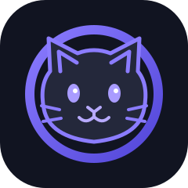

# Uncord

**Your community, your instance.**

A self-hosted Discord-style chat client forked from [Meowcord](https://github.com/meowcorded/meowcord), with a familiar chat experience and room to make it your own.

[Features](#features) · [Self-hosting](#self-hosting) · [Contributing](#contributing) · [License](#license)

---

## What is Uncord?

Uncord is a community-focused fork of Meowcord. It builds on Meowcord’s self-hosted, federated chat platform and its Discord-like web client, while giving the project its own identity and customisations.

The main chat experience is the focus. Supporting pages—including the admin panel and bot developer portal—are being refreshed to feel cleaner and more consistent.

> **Project status:** Uncord is based on an early-stage upstream project. Expect rough edges; don’t use it for anything mission-critical without reviewing and testing it first.

## Features

- **Familiar chat UI** — a Discord-style interface for communities.
- **Federation** — connect with users and communities on other compatible instances.
- **Self-hosting** — run your own instance and control its configuration.
- **Admin tools** — instance and community management interfaces.
- **Bot developer portal** — a place for bot-related tools and configuration.
- **Open source** — AGPL-3.0 licensing; see [LICENSE](LICENSE).

Feature availability depends on the upstream version and your instance configuration.

## Self-hosting

Read the project guides before setting up an instance:

- [Setup with Docker](docs/self-hosting/setup.md)
- [Native Linux setup](docs/self-hosting/native.md)
- [Database options](docs/self-hosting/databases.md)
- [Instance verification](docs/self-hosting/verification.md)

For the Docker setup, the upstream guide uses an environment file. Start by copying `.env.example` to `.env`, then follow the setup guide to configure your instance.

Clone the repository:

    git clone https://github.com/sillyjoshua/uncord.git
    cd uncord

Continue with the instructions in the relevant guide rather than assuming development and production use the same command.

## Contributing

Contributions and bug reports are welcome. Please read [CONTRIBUTING.md](CONTRIBUTING.md) for development conventions and verification steps before opening a pull request.

## Credits

Uncord is a fork of [Meowcord](https://github.com/meowcorded/meowcord). Thanks to the original maintainers and contributors for building the foundation this project is based on.

## License

Uncord is distributed under the **GNU Affero General Public License v3.0 (AGPL-3.0)**. See [LICENSE](LICENSE) for the full terms. Code inherited from upstream remains subject to its applicable notices and license terms.

---

**Uncord** · Same vibes. More freedom.

